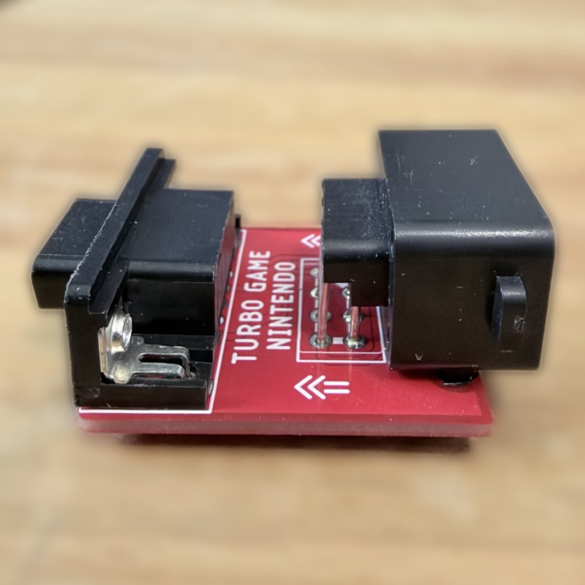
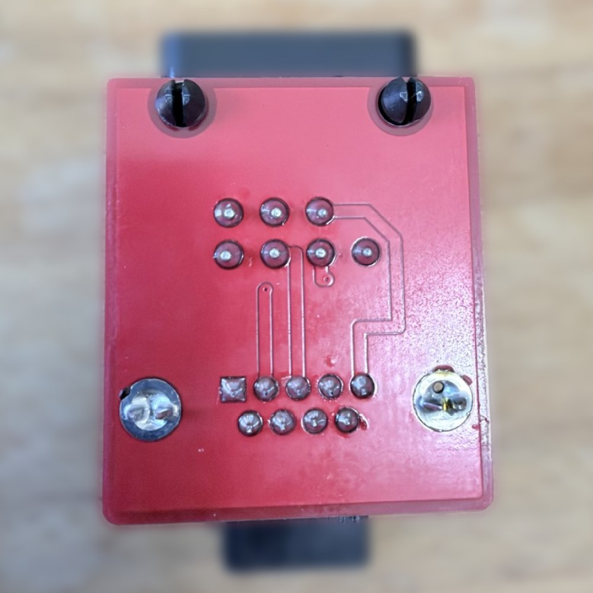
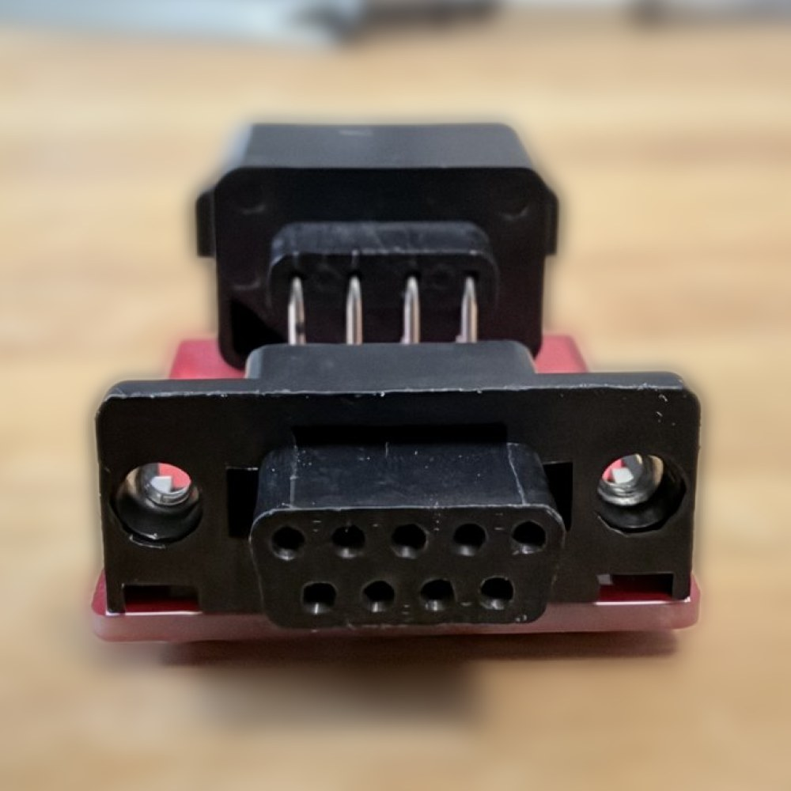
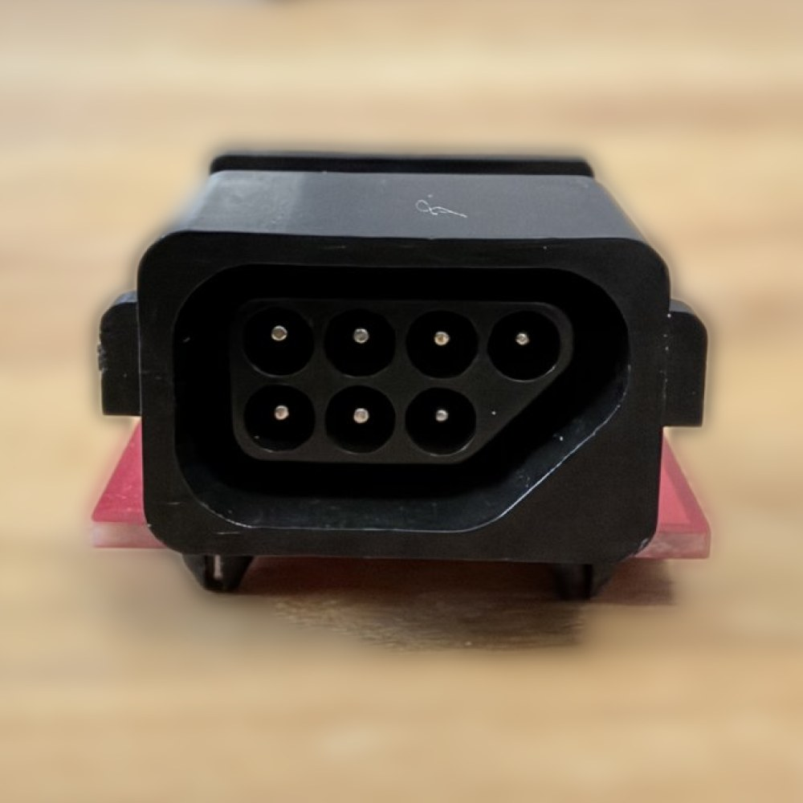

# Case para o adaptador Phantom/Top Game/Turbo Game comprado na Shopee

> **Este modelo vale apenas para o adaptador de terceiros que foi adquirido na [Shopee](https://shopee.com.br/).** Ele **não** serve para as PCBs deste repositório (Geniecom e Phantom), que têm as próprias cases em [`../geniecom`](../geniecom) e [`../phantom`](../phantom).

## O adaptador

PCB **vermelha**, com a serigrafia "TURBO GAME NINTENDO" e setas indicando o sentido de cada lado. As PCBs do repositório são diferentes: a do Geniecom é roxa e a do Phantom tem a serigrafia "NES" e "PHANTOM".

| | |
| --- | --- |
|  |  |
| Vista geral: conector DB9 (lado do console) e conector NES. | Verso, com os terminais soldados e os parafusos do DB9. |
|  |  |
| Conector DB9 fêmea. Atrás dele aparecem os pinos do NES. | Conector NES de 7 pinos. |

## Por que existe

A PCB deste adaptador é diferente das do repositório. A distância da face da moldura do DB9 até a face do conector NES foi medida com paquímetro neste adaptador e deu **42,44 mm**, e a case foi dimensionada em cima dela. Nas PCBs do repositório essa distância é outra (44,79 mm no Geniecom e 40,16 mm no Gerber do Phantom).

## Medidas usadas

| Parâmetro | Valor | Origem |
| --- | --- | --- |
| `nes_front` (moldura do DB9 até a face do NES) | 42,44 mm | Medido neste adaptador (leitura do paquímetro na foto) |
| `nes_body_w` (largura do NES com a moldura) | 24,88 mm | Medido |
| `db9_body_w` (largura da moldura metálica do DB9) | 30,95 mm | Medido (o DB9 é o mesmo das outras PCBs) |
| `nes_h` (altura do NES acima da PCB) | 16,8 mm | Mesmo conector do Geniecom (confirmado) |
| `db9_h` (altura do DB9 acima da PCB) | 12,30 mm | Medido: DB9 + PCB = 13,95 mm, menos 1,65 mm da PCB. Define a altura externa do teto da parte baixa (rente ao topo do DB9) |
| `db9_body_d` (profundidade do corpo do DB9) | 12,5 mm | Footprint (na foto IMG_1670 dá ~12,8 mm). Só define a posição dos parafusos da case |
| `db9_body_h` (altura do corpo do DB9 atrás da moldura) | 10,8 mm | Lido na foto IMG_1670, **a conferir com paquímetro**: o teto encosta nele |
| `db9_plate_d` (borda da frente da moldura do DB9) | 2,16 mm | Medido: o teto começa atrás dela |
| `pcb_t` (espessura da PCB) | 1,65 mm | Medido (as PCBs do Geniecom e do Phantom têm 1,26 mm) |
| `under_h` (espaço sob a PCB) | 4,25 mm | Mesmo valor do Geniecom (confirmado): o que sai por baixo da PCB (pinos de fixação do NES, parafusos do DB9, solda) tem até 3,75 mm, mais 0,5 mm de margem |
| `nes_clear` (folga da janela do NES) | 0,05 mm | Validada no [teste de encaixe do NES](../frame-tests/README.md) |
| `pcb_w` (largura da PCB) | 32,26 mm | Medido com paquímetro (leitura 32,24 a 32,26 mm) |
| `pcb_l` (comprimento da PCB) | 37,73 mm | Medido (o NES avança 4,71 mm além da PCB) |

A largura da cavidade (33,0 mm) é definida pela largura da PCB (32,26 mm), que é 1,31 mm maior que a moldura do DB9 (30,95 mm). O DB9 fica num berço aberto, então essa diferença não aparece na ponta da case.

## Como é a case

Mesmo desenho da [case do Geniecom](../geniecom) (casco e placa de fundo de 2 mm, fechados por quatro parafusos **M3×8 mm** autorroscantes nos quatro cantos, entrando por baixo, escondidos nas paredes de 6,5 mm; batentes das orelhas do NES; nomes gravados no teto), com duas diferenças, porque a ponta do DB9 precisa ocupar o mínimo possível:

- **DB9 exposto, num berço aberto.** As paredes laterais do berço são retas, na largura do rasgo da PCB (sem lombadas internas, que travavam o DB9), e começam 0,3 mm atrás da moldura. O teto começa logo atrás da borda de 2,16 mm da moldura do DB9, encostado nela, rente ao topo do DB9 (20,2 mm de altura externa) e com ~1,5 mm de espessura sobre o corpo, que é mais baixo que a moldura (10,8 mm acima da PCB). Só o DB9 e a PCB entram no console. Versões anteriores com braços laterais altos e teto mais alto que o DB9 não passavam no console.
- **Teto em degrau.** A parte do DB9 tem o teto rente ao topo do DB9 (20,2 mm), e antes do corpo do NES o teto sobe até 27,1 mm. A face externa do degrau fica a 20,34 mm da frente da moldura do DB9 (y = 20,3 a 21,9 mm), a 6,5 mm do corpo do NES. O NES tem, atrás do corpo, uma barra de plástico preta com os pinos (20,90 mm da face do NES até a ponta dela): com o degrau a 4,0 mm do corpo o NES parava 5,36 mm antes do fim; a 6,5 mm ele desce até o fim.

Outros detalhes:

- **Batentes das orelhas do NES:** a PCB não recua quando se empurra o plugue do DB9.
- **Aba sob a PCB:** a base tem uma aba na frente (y = 0,3 a 2,5 mm) que fecha o vão sob a PCB, antes dos parafusos do DB9.
- **Apoios da PCB na base:** blocos nas laterais, sob a PCB, dos dois lados. Do lado do DB9 ficam na frente dos parafusos de fixação do DB9 (que ficam sob a PCB, em y = 6,5 a 12,5 mm).
- **Nomes gravados no teto alto** (baixo relevo, 6 mm): "PHANTOM" e "NES", cada um lido a partir do lado do seu conector.
- **Tamanho externo:** 46,0 × 42,2 mm, com 20,2 mm de altura na parte do DB9 e 27,1 mm na do NES (cavidade de 33,0 × 38,7 mm).

## Arquivos

- `stl/case_base.stl`: placa de fundo, pronta para imprimir (fundo na mesa).
- `stl/case_lid.stl`: casco virado, com o teto alto na mesa. O teto baixo fica no ar e precisa de suporte só nessa região.
- `stl/case_assembly.stl`: conjunto montado, só para visualização (não imprimir).
- `stl/preview_render.png`: pré-visualização.
- `autodeskfusion/case_phantom_3rdparty.py`: script paramétrico (CadQuery) que gera tudo.
- `autodeskfusion/case_*.step`: para importar no Autodesk Fusion.

Para regenerar: `python model3d/phantom-3rdparty/autodeskfusion/case_phantom_3rdparty.py` (precisa de `pip install cadquery`).

## Status

Validada no console Phantom System: o casco e a base impressos com estes parâmetros encaixaram no adaptador e no console, e o NES desce até o fim. A base tem apoios da PCB do lado do DB9 na frente dos parafusos do DB9 e uma aba sob a PCB, na ponta do DB9, que fecha o vão de 4,25 mm entre a base e a PCB. Geometria: malhas fechadas e interferência 0,000 mm³ com os envelopes dos conectores.

Se a case for refeita, conferir com paquímetro a altura e a profundidade do corpo do DB9 atrás da moldura (`db9_body_h` e `db9_body_d`): o teto encosta nele. A posição das soldas do DB9 vem da foto do verso e é aproximada.
